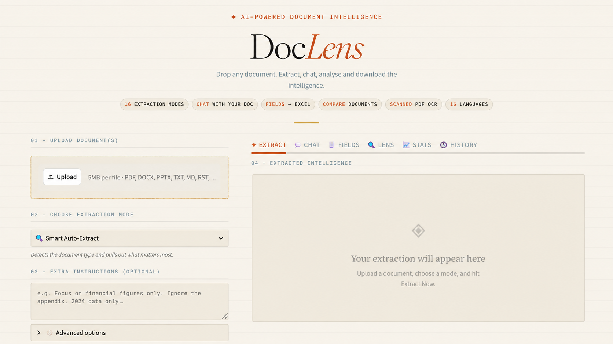
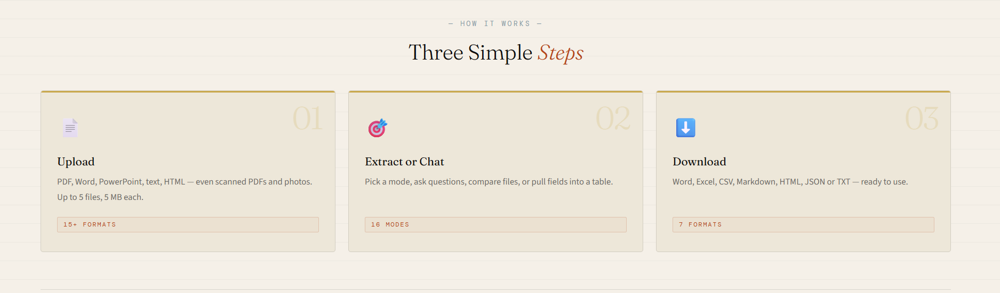
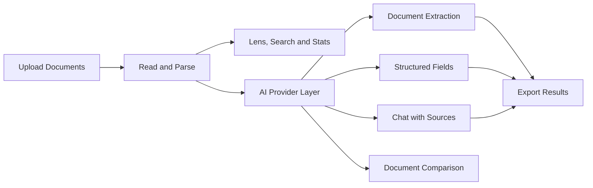
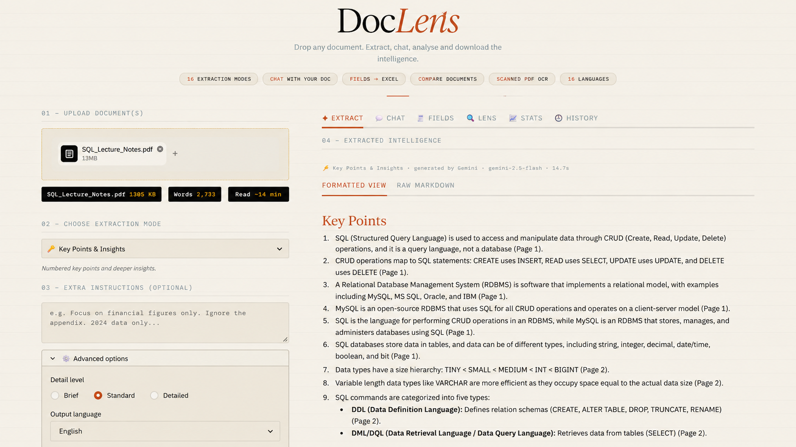
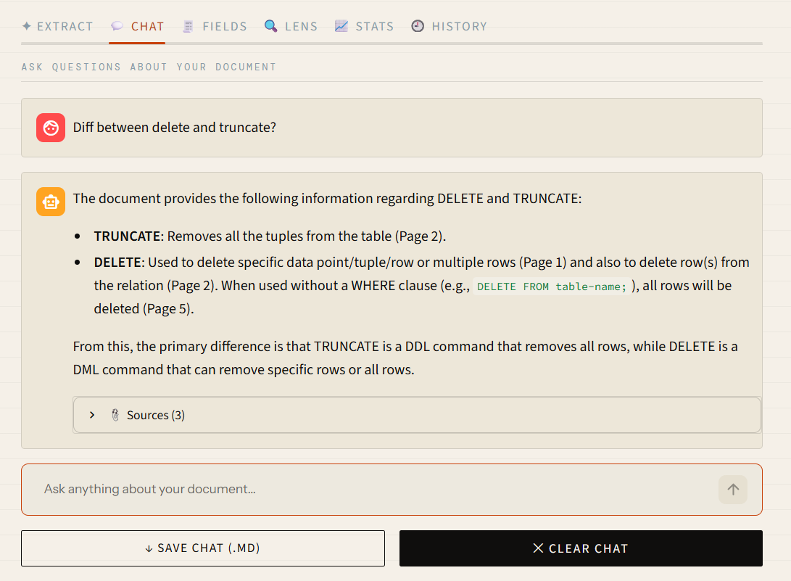
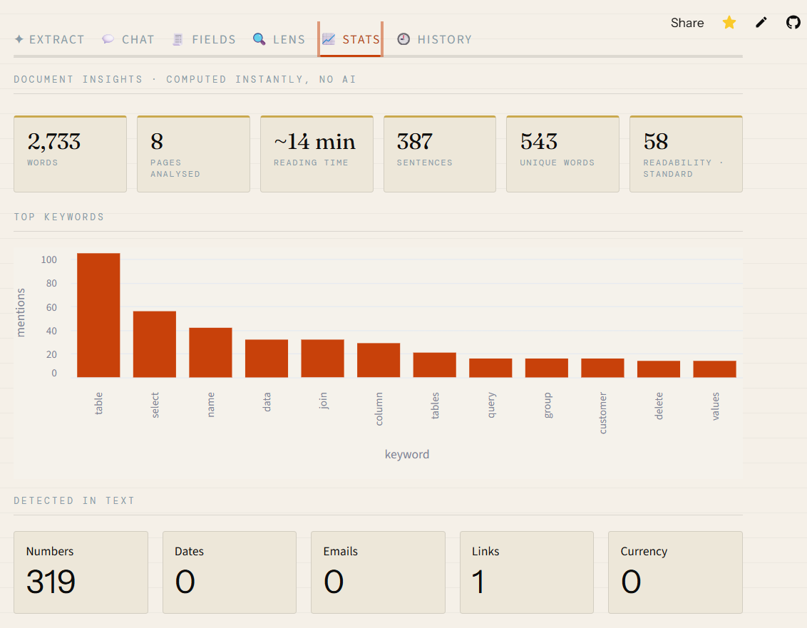

<div align="center">

# DocLens AI

### Read it. Question it. Verify it.

**A document-intelligence web app that doesn't just answer. It shows you where the answer came from.**

[](https://www.python.org/)
[](https://streamlit.io/)
[](https://ai.google.dev/)

[**Live Demo**](https://doclens-ai.streamlit.app/) · [**The Solution**](#the-solution) · [**How It Works**](#how-it-works) · [**Screenshots**](#screenshots) · [**Tech Stack**](#tech-stack) · [**Run Locally**](#run-it-locally)

<br>



</div>

---

## The Problem

Long documents such as contracts, invoices, reports, lecture notes and presentations take time to understand. Traditional document chat tools can provide answers without making it easy to verify where those answers came from.

AI services can also face rate limits, unavailable models and changing API access.

## The Solution

**DocLens AI** turns documents into something you can read, question, analyse and verify. Upload a document, extract useful information, ask questions and export results in formats you can use.

| Feature | What DocLens AI offers |
|---|---|
| ⚡ Document extraction | 16 extraction modes for summaries, key points, risks, timelines, action items and more |
| 💬 Chat with documents | Ask questions and inspect supporting passages and page references |
| 🔍 Document Lens | Search text and highlight useful information, including dates, amounts, emails and key terms |
| 📊 Document analytics | Explore word counts, reading time, keyword frequency and document statistics |
| 🧾 Structured extraction | Extract selected fields across multiple files and export the results |
| 🔀 Document comparison | Compare documents and inspect their similarities |
| 📷 Scanned document support | Use vision-based OCR to read supported scanned PDFs and images |
| 📥 Multiple export formats | Download results in supported formats such as Word, Excel, CSV, Markdown, HTML, JSON and TXT |

<div align="center">
  
</div>

## How It Works

DocLens follows a straightforward workflow:

1. **Upload:** Add supported documents, including PDF, Word, PowerPoint and text files.
2. **Analyse:** Choose an extraction mode, ask questions, compare files or explore document statistics.
3. **Verify and export:** Review the generated results and available source references, then download the output.

### Architecture



## Screenshots

### 1. Document Intelligence — Extraction

Upload a document and extract structured insights, key points and useful information.

<div align="center">
  
</div>

### 2. Chat with Your Document

Ask questions about an uploaded document and inspect the supporting information and source references.

<div align="center">
  
</div>

### 3. Document Statistics and Keyword Analysis

Explore document metrics, reading time, word counts, keyword frequency and detected information.

<div align="center">
  
</div>

## Engineering Decisions

The project focuses on practical challenges involved in building a document-intelligence application.

| Challenge | Approach |
|---|---|
| API availability and rate limits | A provider layer supports configured AI providers and fallback handling. |
| Large documents | Page-range controls and text-condensing strategies help manage context limits. |
| Relevant document chat | Retrieval selects relevant sections to help answer questions about larger documents. |
| Answer verification | Source passages and page references help users check generated answers. |
| Structured extraction | Structured prompts, tolerant parsing and missing-value handling help produce usable results. |
| Scanned PDFs | Page rendering and vision-based OCR help extract text from supported scans. |
| Repeated requests | Caching helps avoid unnecessary repeat processing where applicable. |
| Uploaded content safety | Input handling and sanitisation help reduce risks when displaying document content. |
| Multiple visitors | Session handling and cache isolation help separate users' document-processing state. |

## Tech Stack


## Run It Locally

### 1. Clone the repository

```bash
git clone https://github.com/Shariqueperwez/DocLens-AI.git
cd DocLens-AI
```

### 2. Create and activate a virtual environment

**Windows:**

```bash
python -m venv venv
venv\Scripts\activate
```

**macOS / Linux:**

```bash
python -m venv venv
source venv/bin/activate
```

### 3. Install dependencies

```bash
pip install -r requirements.txt
```

### 4. Configure your API key

Create `.streamlit/secrets.toml` and add your Google Gemini API key:

```toml
GEMINI_API_KEY = "your_key_here"
```

Get an API key from [Google AI Studio](https://aistudio.google.com/apikey).

### 5. Start the application

```bash
streamlit run app.py
```

Open the local URL displayed in your terminal.

> 🔐 **Security:** Never commit real API keys or confidential documents to GitHub. Keep `secrets.toml` out of version control.

## Project Structure

```text
DocLens-AI/
├── app.py
├── core/
│   ├── llm.py
│   ├── documents.py
│   ├── retrieval.py
│   ├── lens.py
│   ├── search.py
│   ├── fields.py
│   ├── prompts.py
│   └── exporters.py
├── doc/
│   ├── showcase.png
│   ├── chats.png
│   ├── extract.png
│   ├── stats.png
│   └── workflow.png
├── .streamlit/
├── requirements.txt
└── README.md
```

## Limitations

- AI providers may enforce rate limits or change model availability.
- Very large documents may need to be processed in page ranges.
- AI-generated answers can contain errors. Check the original document and source references before relying on important information.
- Avoid uploading confidential documents when using services whose data-handling terms are not appropriate for that content.

## Try DocLens AI

<div align="center">

### Read less. Understand more. Verify every answer.

[**Launch DocLens AI**](https://doclens-ai.streamlit.app/)

Built by [**Sharique Perwez**](https://github.com/Shariqueperwez)

If you find this project useful, consider giving the repository a ⭐.

</div>
