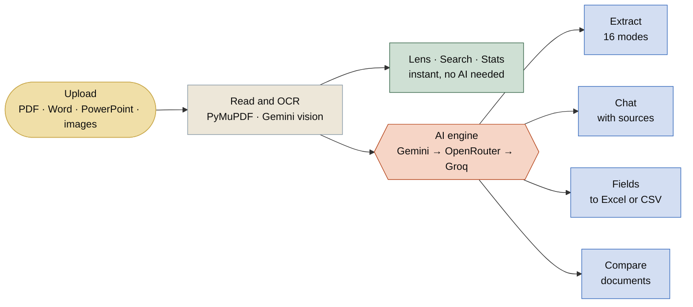

<div align="center">


<br>

**A document-intelligence web app that doesn't just answer. It shows you where the answer came from.**

<br>


<br>

[**The solution**](#the-solution) &nbsp;·&nbsp; [**How it works**](#how-it-works) &nbsp;·&nbsp; [**Engineering**](#engineering-decisions) &nbsp;·&nbsp; [**Screenshots**](#screenshots) &nbsp;·&nbsp; [**Run it**](#run-it-locally)

<br>


<br>


</div>

## The problem

Long documents (contracts, invoices, reports, slide decks) are slow to read, and "chat with your PDF" tools make you trust an AI answer without any way to check it. Most also break the moment a free API key is rate-limited or a model is retired.

## The solution

DocLens turns a document into something you can **read, question and verify**.

| | You want to… | DocLens gives you… |
|:-:|---|---|
| ⚡ | Understand it fast | 16 extraction modes: summary, risks, timeline, action items, study notes and more |
| ✅ | Trust the answer | Chat that cites page/slide numbers and lists the exact source passages |
| 🔍 | See what matters | A reader that highlights dates, amounts, emails and key terms, with instant search |
| 🧾 | Get data out | A table of fields you choose across up to 5 files, exported to Excel or CSV |
| 🔀 | Spot differences | Document comparison with a similarity score |
| 📷 | Read scans | Vision-based OCR for scanned PDFs and photos |

<div align="center"></div>

## How it works



<div align="center"></div>

## Engineering decisions

The interesting parts of this project were the problems underneath the features.

| | Challenge | What I did |
|:-:|---|---|
| 🆓 | **Free APIs fail** (keys expire, models retire, limits hit) | Provider layer with automatic failover: Gemini → OpenRouter → Groq, model by model. Model names are configurable without code changes. |
| 📚 | **A 5,000-page PDF can't fit in a prompt** | PyMuPDF for fast parsing (about 0.1 s for 5,000 pages), a default 300-page window, a page-range picker, and map-reduce condensing that reports how much it covered instead of silently dropping text. |
| 🎯 | **Chat on big files loses the middle** | TF-IDF-style retrieval picks the most relevant sections for each question, so chat stays fast and accurate. |
| ✅ | **Users can't verify AI output** | Every answer shows its source passages; a no-AI reader highlights the facts in the original text. |
| 🧾 | **Structured extraction is brittle** | Strict JSON prompts, tolerant parsing, a "Not found" rule instead of guessing, and per-file isolation so one failure doesn't break the batch. |
| 📷 | **Scanned documents have no text** | Pages with nothing readable are detected automatically, rendered to images with PyMuPDF and transcribed with Gemini vision (up to 16 pages per run). Results are cached per session so a scan is never read twice. |
| 💸 | **Free-tier quotas run out fast** | Repeat extractions are served from a cache, chat sends at most about 80,000 characters through retrieval, Gemini's reasoning effort is set low, and the Fields table remembers finished files so a retry only re-runs what failed. |
| 🛡️ | **Uploaded files can't be trusted** | Document text is HTML-escaped before highlighting, and exported HTML has scripts and event handlers stripped, so a malicious file can't inject code into the page. |
| 🔒 | **Privacy in a shared web app** | Per-visitor sessions, verified with a two-user test; server caches are keyed by content and expire after 30 minutes. |

<div align="center"></div>

## Screenshots

<table>
  <tr>
    <td width="50%" valign="top" align="center"><b>Instant insights, no AI needed</b><br><br></td>
    <td width="50%" valign="top" align="center"><b>On a phone</b><br><br></td>
  </tr>
</table>

<!--
  Add a real Extract screenshot after you deploy:
  1. Run an extraction, take a screenshot, save it as docs/screenshots/extract.png
  2. Replace this comment with:  
-->

## Tech stack


<div align="center"></div>

## Run it locally

```bash
git clone https://github.com/Shariqueperwez/DocLens-AI.git
cd DocLens-AI
python -m venv venv
venv\Scripts\activate          # macOS/Linux: source venv/bin/activate
pip install -r requirements.txt
```

Add a free key from [aistudio.google.com/apikey](https://aistudio.google.com/apikey) in `.streamlit/secrets.toml`:

```toml
GEMINI_API_KEY = "your_key_here"
```

```bash
streamlit run app.py
```

> 🔐 `secrets.toml` is git-ignored. Never commit a real key.

<details>
<summary><b>Project layout</b></summary>

<br>

```
app.py              Streamlit interface
core/llm.py         Providers, streaming, failover, vision OCR
core/documents.py   File readers, page ranges, analytics
core/retrieval.py   Relevance search for large documents
core/lens.py        Highlight reader and document-type hints
core/search.py      Instant search and similarity
core/fields.py      Structured extraction → table
core/prompts.py     Modes, citation rules, language support
core/exporters.py   Word / Excel / CSV / Markdown / HTML / JSON / TXT
```

</details>

<details>
<summary><b>Limitations</b></summary>

<br>

- Free AI tiers are rate-limited, and on Google's free tier prompts may be used to improve its products, so avoid confidential files.
- Documents over about 600 pages must be analysed in page ranges.
- AI output can be wrong. The reader and source passages exist so you can check it.

</details>

<br>

<div align="center">


**Built by [Sharique](https://github.com/Shariqueperwez)**

<sub>If DocLens helped you, a ⭐ on the repo means a lot.</sub>

</div>
