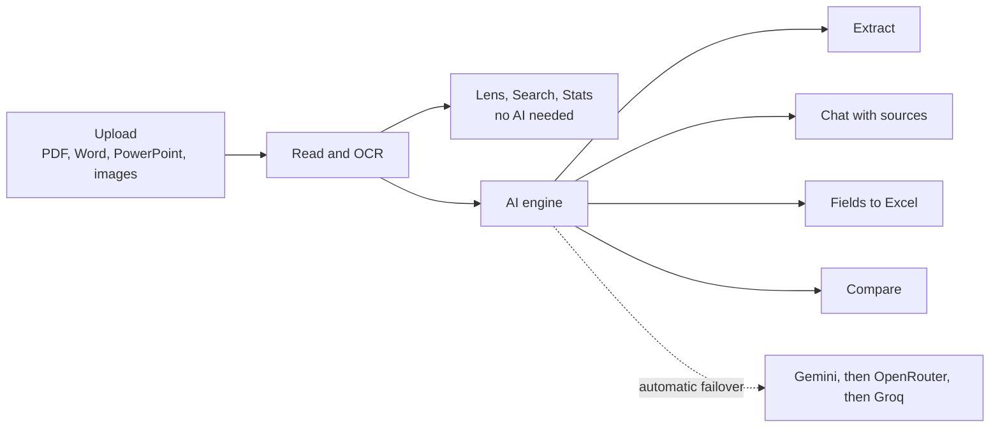

<div align="center">

# ◈ DocLens AI

### Read any document through an AI lens.

Extract insights, chat with your files, compare versions and export to Excel.<br>
**Free to run · no credit card · works on phones**

[](https://www.python.org/)
[](https://streamlit.io/)
[](https://aistudio.google.com/apikey)
[](https://github.com/Shariqueperwez)

<br>


</div>

<br>

## Why DocLens?

Most "chat with your PDF" tools give you an answer and ask you to trust it. DocLens is built around **seeing and checking** the document, not only summarising it.

- 🔍 **See it** — read any file with dates, amounts, emails and key terms colour-highlighted, with instant search and page numbers. No AI needed.
- 📎 **Verify it** — every chat answer shows the exact passages it came from.
- 🧾 **Use it** — pull specific fields from many files into a table and download it as Excel.

---

## Features

### Understand
| | |
|---|---|
| **16 extraction modes** | Smart Auto, Summary, Key Points, Data & Stats, Action Items, Concepts, Legal, Risks & Red Flags, Entities, Timeline, Q&A, Study Notes & Flashcards, Explain Simply, Tone & Sentiment, Compare Documents, Full Report |
| **Chat with sources** | Ask follow-up questions; each answer cites pages/slides and lists the passages it used |
| **Lens reader** | Page-by-page reader with highlighted dates, amounts, emails, links and key terms, plus search |
| **Smart hint** | Recognises invoices, contracts, résumés, papers and more, and suggests the best mode |
| **Compare** | What changed between two versions, conflicting numbers, and a similarity score |

### Extract & export
| | |
|---|---|
| **Fields → Excel** | Type the fields you want (or use Invoice / Résumé / Contract / Receipt templates) and run them across up to 5 files |
| **7 export formats** | Word, Excel, CSV, Markdown, HTML, JSON, TXT |

### Built for real documents
| | |
|---|---|
| **Scanned PDFs & photos** | Gemini vision reads scans and images (`.png` `.jpg` `.webp`) |
| **Huge files** | Page-range picker (`1-50, 120-180`), a clear "analysing pages X of Y" notice, and smart retrieval for chat on very large documents |
| **16 output languages** | English, Hindi, Hinglish, Urdu, Bengali, Tamil, Telugu, Marathi, Gujarati, Spanish, French, German and more |
| **15+ file types** | PDF, DOCX (with tables), PPTX (with notes), TXT, MD, CSV, JSON, HTML, images… |

### Built to be reliable
| | |
|---|---|
| **Automatic failover** | Gemini → OpenRouter → Groq, model by model, so one rate limit doesn't stop the app |
| **Private sessions** | Each visitor only ever sees their own uploads, chats and history |
| **Phone & tablet ready** | Responsive layout, thumb-sized buttons, no iPhone input zoom, auto-scroll to results |

---

## Screenshots

<table>
  <tr>
    <td width="50%" valign="top"><b>Instant insights — no AI needed</b><br><br></td>
    <td width="50%" valign="top"><b>Works on your phone</b><br><br></td>
  </tr>
</table>

<!--
  Add a real Extract screenshot after you deploy:
  1. Run an extraction, take a screenshot, save it as docs/screenshots/extract.png
  2. Replace this comment with:  
-->

---

## Quick start

```bash
git clone https://github.com/Shariqueperwez/DocLens-AI.git
cd DocLens-AI

python -m venv venv
venv\Scripts\activate            # macOS / Linux:  source venv/bin/activate
pip install -r requirements.txt
```

**1. Get a free Gemini key** (no credit card): <https://aistudio.google.com/apikey>

**2. Save it.** Create `.streamlit/secrets.toml`:

```toml
GEMINI_API_KEY = "your_key_here"
```

**3. Run it**

```bash
streamlit run app.py
```

Open <http://localhost:8501> and drop in a document.

> 🔐 `secrets.toml` is git-ignored. Never commit a real key.

### Deploy for free (Streamlit Community Cloud)
1. Push this repo to GitHub (public).
2. On [share.streamlit.io](https://share.streamlit.io) click **Create app**, choose this repo, main file `app.py`.
3. Under **Advanced settings → Secrets**, paste `GEMINI_API_KEY = "your_key_here"` and deploy.

The key stays on the server. Visitors never see or enter one.

---

## Configuration

All optional except the first key. Put these in `.streamlit/secrets.toml` (or Streamlit Cloud → Secrets).

| Key | Purpose |
|---|---|
| `GEMINI_API_KEY` | Primary AI provider — free tier, supports scanned-page vision |
| `OPENROUTER_API_KEY` | Fallback provider (free models) |
| `GROQ_API_KEY` | Fallback provider |
| `GEMINI_MODEL`, `OPENROUTER_MODEL`, `GROQ_MODEL` | Override a model name if a provider retires one — no code change needed |

Limits you can change: `maxUploadSize` in `.streamlit/config.toml` (default 5 MB) and `MAX_FILES` in `app.py` (default 5).

---

## How it works



Large documents are handled honestly: DocLens reads the first 300 pages by default (or the range you choose), condenses text that exceeds a provider's limit section by section, and tells you when anything couldn't be covered.

---

## Project structure

```
app.py                 Streamlit interface
assets/style.css       Editorial theme + responsive rules
core/
  llm.py               Providers, streaming, failover, vision OCR, long-text condensing
  documents.py         File readers, page ranges, analytics
  prompts.py           The 16 modes, detail levels, languages, citation rules
  lens.py              Highlight reader, page sections, document-type hints
  search.py            Instant search and document similarity
  retrieval.py         Relevance search for chat on large documents
  fields.py            Structured field extraction → table
  exporters.py         TXT / MD / HTML / JSON / DOCX / XLSX / CSV
docs/screenshots/      README images
```

---

## Privacy & limitations

- **Private by design.** Every visitor has their own session; uploads, chat and history are visible only to them and vanish on refresh. DocLens writes nothing to disk. Short-lived memory caches expire after 30 minutes and are never shown to other visitors.
- **Your text goes to the AI provider** to answer a request. On Google's *free* tier, prompts may be used to improve Google products (outside the EU/UK/CH), so don't upload confidential documents with a free key.
- **Free tiers have rate limits** (a few requests a minute). DocLens retries and falls back automatically, but heavy use can still hit them.
- **AI can be wrong.** Check anything important, especially legal and financial details. That's what the Lens reader and chat sources are for.
- Scanned-page OCR reads up to 16 pages per run.

---

## Tech stack

Python · Streamlit · Google Gemini (OpenAI-compatible API) · PyMuPDF · python-docx · python-pptx · openpyxl · pandas

---

<div align="center">

**Built by [Sharique](https://github.com/Shariqueperwez)**

If DocLens helped you, a ⭐ on the repo means a lot.

</div>
